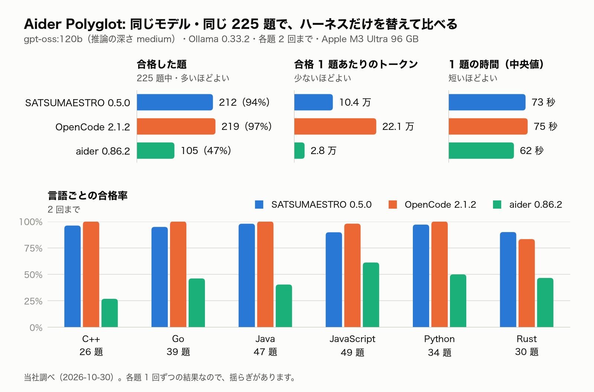

# SATSUMAESTRO

ローカル LLM でも動く、端末で使うエージェント型コーディング CLI です。

SATSUMAESTRO は、コードを読み、計画を立て、ファイルを書き換え、コマンドを実行する、という作業を
「モデルの応答を流す → ツールを呼ぶ → 権限を確かめる → 実行する → 結果を返す」の繰り返しで、作業が
終わるまで進めます。自分で動かすモデル（[Ollama](https://ollama.com)）でうまく動くように作っていて、
OpenAI 互換のサーバやクラウドの API も使えます。

[English README](README.md)

- **ローカルが先**: 手元や LAN の中のモデルで動きます。依頼は設定した接続先へ送り、Web 検索と
  Web 取得は既定で無効です
- **計画してから作る**: plan モードでは計画ファイルを書き、何かを変える前に承認を求めます。承認した
  計画は段ごとに進みます
- **何を動かすかは自分で決める**: Markdown 1 つの権限ポリシー・確認カード・作業場所の外へ出ない
  パスの制限（jail）・秘密ファイルの保護
- **日本語と英語**: 応答は書いた言語に合わせ、画面は日本語か英語を選べます
- **そのほか**: MCP サーバ・言語サーバ（LSP）・作業場所の索引（RAG）

## 目次

- [動作環境](#動作環境)
- [入れ方](#入れ方)
- [Ollama で始める](#ollama-で始める)
- [モデルの選び方](#モデルの選び方)
- [文脈の窓](#文脈の窓)
- [ほかのツールとの比較](#ほかのツールとの比較aider-polyglot)
- [REPL の使い方](#repl-の使い方)
- [プロバイダ](#プロバイダ)
- [設定と信頼](#設定と信頼)
- [権限と安全](#権限と安全)
- [Web 検索と Web 取得](#web-検索と-web-取得)
- [任意の機能](#任意の機能)
- [別のマシンの Ollama を使う](#別のマシンの-ollama-を使う)
- [LM Studio で使う](#lm-studio-で使う)
- [llama.cpp で使う](#llamacpp-で使う)
- [貢献・セキュリティ・ライセンス](#貢献セキュリティライセンス)

## 動作環境

- macOS・Linux・Windows（WSL2 の中。[Windows（WSL2）](#windowswsl2)）。Windows で直接起動すると、起動時に
  止まって WSL2 を案内します
- Python 3.12 以上（無ければ `uv` が入れます）
- **tool calling に対応したモデル**（Ollama かほかのプロバイダ。[プロバイダ](#プロバイダ)）。tool の
  呼び出しを本文に書くだけでツールを動かせないモデルでは、生の JSON を回答にせず、はっきりした
  エラーで止まります

## 入れ方

```bash
uv tool install satsumaestro      # または pipx install satsumaestro
satsumaestro --version
```

`satsumaestro`・`satsuma`・`stro` は同じコマンドです。GitHub の最新のソースから入れるなら:

```bash
uv tool install git+https://github.com/KATOI-T/SATSUMAESTRO
```

更新は `uv tool upgrade satsumaestro`、削除は `uv tool uninstall satsumaestro` です。
[uv](https://docs.astral.sh/uv/) が無ければ `curl -LsSf https://astral.sh/uv/install.sh | sh` で入れます。

macOS と Linux では [Homebrew](https://brew.sh) でも入れられます。

```bash
brew install katoi-t/tap/satsumaestro
```

更新は `brew upgrade satsumaestro`、削除は `brew uninstall satsumaestro` です。最初に入れるときは、
依存の一部をソースからビルドするので数分かかります。

### Windows（WSL2）

SATSUMAESTRO は Windows では直接動きません。WSL2（Windows Subsystem for Linux）の中で使います。

1. PowerShell を管理者として開き（「管理者として実行」）、WSL2 と Ubuntu を入れて Windows を再起動します
   ```powershell
   wsl --install
   ```
2. 再起動すると Ubuntu が開き、Linux のユーザー名とパスワードを決めるよう求められます。次からは
   スタートメニューか、PowerShell の `wsl` で起動します。`wsl -l -v` で `VERSION` が `2` なら準備できています
3. Ubuntu の端末で、uv と SATSUMAESTRO を入れます
   ```bash
   curl -LsSf https://astral.sh/uv/install.sh | sh
   source $HOME/.local/bin/env        # または端末を開き直す
   uv tool install satsumaestro
   ```
4. Ollama を次のどちらかで用意し、[Ollama で始める](#ollama-で始める)へ進みます
   - **Ubuntu の中に入れる**（いちばん簡単）: `curl -fsSL https://ollama.com/install.sh | sh`。NVIDIA の
     GPU があれば、Windows 側に最新の NVIDIA のドライバを入れます。WSL2 はそれを使うので、Ubuntu の中に
     GPU のドライバを入れないでください
   - **Windows 版の Ollama を使う**: WSL2 から Windows の Ollama へつなぐ設定は、Microsoft の文書
     [WSL を使用したネットワーク アプリケーションへのアクセス](https://learn.microsoft.com/ja-jp/windows/wsl/networking)
     をご覧ください
5. 作業するプロジェクトは `/mnt/c/` の下ではなく、Linux 側（例: `~/projects`）に置いてください。WSL2 から
   Windows のファイルを読み書きすると、ずっと遅くなります

## Ollama で始める

1. [Ollama](https://ollama.com) を入れ、メモリに合ったモデルを取得します（[モデルの選び方](#モデルの選び方)）
   ```bash
   ollama pull qwen3:8b
   ```
2. モデルの文脈の窓を 16K トークン以上にします（[文脈の窓](#文脈の窓)）
3. Ollama の場所と使うモデルを `~/.satsuma/settings.json` に書きます
   ```json
   {"provider": {"base_url": "http://localhost:11434/v1", "default_model": "qwen3:8b"}}
   ```
   モデルは必ず書きます（未設定のままだと、最初の依頼で Ollama に断られます）。シェルの
   `OLLAMA_HOST` / `OLLAMA_MODEL` でも構いません
4. 設定を確かめてから、作業するディレクトリで REPL を起動します
   ```bash
   satsumaestro doctor --probe
   cd your-project
   satsumaestro
   ```
   初めて開くディレクトリでは、信頼するかを聞きます（[設定と信頼](#設定と信頼)）。初めて REPL を
   起動したときは、画面の言語を聞きます

## モデルの選び方

メモリの帯ごとに 2 つまで挙げます。1 つ目は Qwen の系統、2 つ目は gpt-oss（36-64 GB の帯は Qwen）です。どれも
`ollama pull` できる公式の名前です。

| メモリ（Mac の例） | 1 つ目 | 2 つ目 |
|---|---|---|
| 16 GB（16・18 GB） | `qwen3:8b`・窓 16K | — |
| 24-32 GB（24・32 GB） | `qwen3:14b`・窓 16K | `gpt-oss:20b`・窓 32K |
| 36-64 GB（36・48・64 GB） | `qwen3-coder:30b`・窓 32K | `qwen3.8:27b`・窓 32K |
| 96 GB 以上 | `qwen3-coder-next:q4_K_M`・窓 256K | `gpt-oss:120b`・窓 128K |

- 窓は、重みと KV キャッシュ（Ollama の既定の f16）が、GPU に使える量に収まるいちばん大きな値です。
  macOS が GPU に使わせるのは本体のメモリの 2/3〜3/4 で、16 GB で約 11 GB・32 GB で約 21 GB・36 GB で約 27 GB・
  48 GB で約 36 GB です
- 16 GB に 2 つ目が無いのは、`gpt-oss:20b` が M2 Air（16 GB）で落ち、`qwen3:14b` も窓 8K で約 10.8 GB と
  枠をわずかに超えるためです
- 36-64 GB の窓 32K は、Ollama がこの帯の GPU で使う既定と同じなので、窓の設定を変えずに使えます。48 GB 以上は
  64K にしても収まりますが、精度の差は測っていません
- `qwen3:14b` の 16K・`qwen3-coder:30b` と `qwen3.8:27b` の 32K は、開発機での計算の目安です（24〜64 GB の
  実機では確かめていません）

## 文脈の窓

文脈の窓（Ollama の `num_ctx`）が小さいと、書き込みのたびに履歴を畳むことになり、精度が落ちます。
窓は次の順で決まります。

1. Modelfile の `PARAMETER num_ctx`（あればこれ）
2. サーバの既定 `OLLAMA_CONTEXT_LENGTH`（未設定なら Ollama の既定。小さいことが多い）

窓の内訳は、`satsumaestro doctor --probe` の `context window` の行で見られます（REPL の `/model` でモデルを
替えたときにも出ます）。

```
文脈の窓 16,384 トークン（Modelfile の num_ctx）: 最初の要求 約 3,754・会話に使える量 約 9,353（13,107 から履歴を畳む）
```

- **最初の要求**: 毎回送る system prompt・指示ファイル・ツール定義。窓の小さいモデルでは指示ファイルを窓の 1/8 までに切ります
- **会話に使える量**: 圧縮の閾値（窓の 8 割）から最初の要求を引いた残り。依頼・読んだファイル・書いた本文に使えます
- 会話に使える量が最初の要求の 2 倍に届かないと、REPL の起動時に窓を広げる案内が出ます（8K のモデルなど）

窓を広げるには、次の 3 通りのどれかにします（窓を広げるとメモリを多く使います。読み込んだ後の大きさは
`ollama ps` で見られます）。

- **Ollama のアプリ**: Settings の Context length を動かす
- **`ollama serve`（Homebrew など）**: 環境変数 `OLLAMA_CONTEXT_LENGTH` でサーバの既定を変える
- **モデルごと**: Modelfile の `PARAMETER num_ctx` で、窓を決めた版を作る

```bash
OLLAMA_CONTEXT_LENGTH=16384 ollama serve            # その場で起動するとき
launchctl setenv OLLAMA_CONTEXT_LENGTH 16384 && brew services restart ollama   # brew のサービスのとき
```

```
# Modelfile（モデルごとに決める）。ollama create qwen3:8b-ctx16k -f Modelfile で作る
FROM qwen3:8b
PARAMETER num_ctx 16384
```

参考: Ollama の文書の [Context length](https://docs.ollama.com/context-length)（窓の変え方）

## ほかのツールとの比較（Aider Polyglot）

同じモデル・同じ題・同じ条件で、ハーネスだけを替えて、Aider Polyglot の全 225 題（C++・Go・Java・
JavaScript・Python・Rust）を解かせました（当社調べ・2026-10-30）。



| | SATSUMAESTRO | OpenCode 2.1.2 | aider 0.86.2 |
|---|--:|--:|--:|
| 合格（2 回まで） | 212（94.2%） | 219（97.3%） | 105（46.7%） |
| 1 回目で合格 | 183（81.3%） | 186（82.7%） | 36（16.0%） |
| 不合格 | 13 | 6 | 120 |
| 1 題の時間（中央値） | 73 秒 | 75 秒 | 62 秒 |
| 合格 1 題あたりのトークン | 約 10.4 万 | 約 22.1 万 | 約 2.8 万 |
| 1 題の往復（中央値） | 8 | 13 | 2 |

言語ごとの合格（2 回まで）:

| 言語 | 題の数 | SATSUMAESTRO | OpenCode | aider |
|---|--:|--:|--:|--:|
| C++ | 26 | 25 | 26 | 7 |
| Go | 39 | 37 | 39 | 18 |
| Java | 47 | 46 | 47 | 19 |
| JavaScript | 49 | 44 | 48 | 30 |
| Python | 34 | 33 | 34 | 17 |
| Rust | 30 | 27 | 25 | 14 |
| **合計** | **225** | **212** | **219** | **105** |

- SATSUMAESTRO の合格は OpenCode をわずかに下回り（212 対 219）、時間はほぼ同じで、合格 1 題あたりの
  トークンは半分以下です（1 往復で読み込む量が小さく、往復も少ないため）
- aider は、aider の公式の benchmark と同じ作りで回しました。自分でテストを実行しないので、1 回目の合格が
  低く出ます。また、この測定では C++ のヘッダ（`.h`）を C として文法検査したので、C++ が特に低くなりました
- 各題 1 回ずつの結果なので、揺らぎがあります

**条件**: gpt-oss:120b・推論の深さ medium（3 つに同じ値）・Ollama 0.33.2・窓 131072・Apple M3 Ultra 96 GB・
各題 2 回まで（1 回目に落ちたら、テストの出力を見せてもう 1 回。1 回 20 分・テスト 3 分）・3 つを 1 題ずつ交互に
回す・ウェブは使わない。SATSUMAESTRO は 0.5.0 の直前の開発版で測りました。自分で回す手順は
[CONTRIBUTING.md](CONTRIBUTING.md#evaluations)（英語）にあります。

## REPL の使い方

```bash
satsumaestro                          # 対話 REPL（おすすめ。satsumaestro repl と同じ）
satsumaestro -m qwen3:14b             # モデルを替えて起動
satsumaestro prompt "say hi"          # 一発実行（非対話）
satsumaestro prompt "認証周りの改修計画を立てて" --mode plan   # plan モードで起動（プロジェクトのファイルは変えない）
satsumaestro prompt "say hi" --output-format json             # JSON 出力
satsumaestro session list             # セッション一覧（再開は satsumaestro session resume <id>）
satsumaestro models                   # モデルの略称の一覧
satsumaestro config show              # 重ねた後の設定
satsumaestro doctor                   # 設定・プロバイダ・鍵・ポリシーの診断
```

REPL では `/help` でコマンドの一覧、`/exit` か Ctrl-D で終了、Ctrl-C で今のターンを中断します。REPL を
閉じると、その REPL が使ったモデルを Ollama から降ろします（残すなら設定で
`provider.ollama.unload_on_exit: false`）。LM Studio と llama.cpp の router からは、その REPL が読み込ませたモデルだけを降ろします
（残すなら `provider.local.unload_on_exit: false`）。`/provider` でローカルのサーバから切り替えたときも、同じように降ろします。

**モード**: メインモードは `plan` か `code`（既定 `code`）で、プロンプトの接頭辞 `[plan] satsuma>`（緑）/
`[code] satsuma>`（青）に出ます。

- **Shift+Tab** で plan と code を切り替えます。`/mode` で現在値、`/mode plan`・`/mode code read-only` のように
  直接指定もできます。`--mode plan|code|code:<sub>` で起動時に指定でき、モードはセッションに保存されます
- **plan** の間は、読み取り系のツールと計画ファイル `.satsuma/plans/<session_id>.md` への書き込みだけが
  許されます。モデルが `exit_plan_mode` を呼ぶと、計画を描いた**承認カード**が出ます。`y` で code モードへ
  戻って実装へ、`a` なら承認しつつ「実装のときに反映させる一言」（例: テストも追加して）を 1 行添えて、`n`
  なら直してほしい点を 1 行書いてモデルに計画を直させます。計画が出た後に「進めて」と言っても承認に
  なります。非対話の `prompt` では自動で承認しません
- `code` の下の権限サブモードは `read-only`・`workspace-write`（既定）・`danger-full-access`・`prompt`・
  `allow` のどれかです。既定のときは接頭辞に出さず、変えたときだけ `[code:read-only]` のように付きます。
  `/sub-mode` で確認と変更ができます

**言語**: 発話ごとに言語を判定し、その言語で答えるようモデルに伝えます。応答が別の言語だったときは、
書き直しを 1 回だけ求めます。対応は日本語と英語です。

- `/lang` で現在値、`/lang ja|en` で固定、`/lang auto` で自動判定へ戻します。設定は `language.mode`
  （`auto` / `fixed` / `off`）・`language.fixed`・`language.repair`（`false` で書き直しの往復を省く。ローカル
  モデルでは数十秒かかることがあります）
- `/language ja|en|auto` で画面の言語（メニュー・カード・通知・ヘルプ）を切り替え、`~/.satsuma/settings.json`
  の `language.ui` に記録します。応答の言語は変えません

**ファイル変更の表示**: 編集系のツールは、引数を生成している間に書き込む内容が画面へ流れ、実行の直前に
差分が出ます（端末のみ）。`stream_tool_args: false` で流す表示だけを切れます。

## プロバイダ

プロバイダは、REPL の `/provider` か設定の `provider.kind` で選びます（`ollama`・`lmstudio`・`llamacpp`・
`openai`・`anthropic`・`xai`）。`/provider` だけで、プロバイダごとの接続先か鍵の有無を出します。
`/provider <名前> [URL] [モデル]` で会話の途中に切り替え、`~/.satsuma/settings.json` に保存します。
`/model` もモデルをそこに保存し、次の起動では最後に選んだプロバイダとモデルを使います。

```text
/provider llamacpp http://192.168.1.20:9931/v1
/provider ollama
/provider anthropic claude-sonnet-5-5
/provider xai grok-4.3
```

- ローカルのサーバの接続先は、`provider.base_url` か、`OLLAMA_HOST`・`LMSTUDIO_HOST`・`LLAMACPP_HOST`
  （ホスト・`ホスト:ポート`・URL。環境変数か `.env`）
- クラウドには、環境変数か `.env` の API の鍵が要ります。鍵は設定に書きません
- `provider.kind` を決めると、モデル ID や `OLLAMA_HOST` ではプロバイダが変わりません。下の自動の選び方に
  戻すには `"kind": "auto"` にします

`auto`（既定）では、リクエストを送るプロバイダは次の順に決まります。

1. `provider.base_url` か `OLLAMA_HOST` がある → その接続先（OpenAI 互換）。このとき、モデル名だけでは有料の
   クラウドの API へ送りません
2. モデル ID でプロバイダが分かる（`claude-…`・`gpt-…`・`grok-…` など）→ そのプロバイダ
3. `OPENAI_BASE_URL` がある → その OpenAI 互換のサーバ（LM Studio・llama.cpp・mlx-lm・vLLM・OpenRouter など）
4. 最初に見つかった API の鍵: `OPENAI_API_KEY`・`ANTHROPIC_API_KEY`・`XAI_API_KEY`
5. どれも無ければ OpenAI 互換。接続先の設定の仕方（`provider.base_url`・`OPENAI_BASE_URL`・`OLLAMA_HOST`）を案内します

接続先を設定しないと、環境の API の鍵でクラウドのプロバイダを選ぶことがあります。手元や LAN の中だけで
使うなら、`provider.base_url` か `OLLAMA_HOST` を設定してください。

モデルは `--model` / `-m`・`OLLAMA_MODEL`・設定の `provider.default_model` のどれかで指定します。

## 設定と信頼

設定は次の順に重ね（後勝ち）、明示値の無い項目だけを `.env` と環境変数で補います。

1. `~/.satsuma/settings.json`（ユーザー設定。置き場所は `SATSUMA_CONFIG_HOME` で変えられる）
2. `.satsuma.json`
3. `.satsuma/settings.json`
4. `.satsuma/settings.local.json`

ただし、最後に選んだプロバイダとモデル（ユーザー設定の `provider.kind`・`provider.base_url`・
`provider.default_model`）は、2〜4 より優先します。

2〜4・`.env`・`.satsuma/memory.md`・スキルの置き場所は、作業ディレクトリから git の根まで（git の外なら
作業ディレクトリだけ）を探し、いちばん近いものを使います。`.satsuma/policy.md` は重ねます。git の根から
作業ディレクトリまでのすべての `policy.md` の規則が効くので、根の Deny はサブディレクトリでも効きます。
基準のモードは、`mode:` を書いたいちばん近いファイルのものです。

会話の記録・計画・索引などの手元の状態は `.satsuma/` の下に書きます。初めて書くときに
`.satsuma/.gitignore` を置き、これらがコミットされないようにします（`settings.json`・`policy.md`・
`memory.md`・`skills/` は共有できるまま）。

2〜4・`.env`・`.satsuma/policy.md`・`.satsuma/memory.md`・`.satsuma/skills` はリポジトリに同梱でき、
フック・MCP サーバ・LSP サーバ・権限モード・接続先を書けるので、**信頼したディレクトリでだけ**読みます。

- 初めて開くディレクトリでは、`repl` が起動時に確認します（`y` 信頼して記録する・`n` 今回は読まずに続ける・
  `q` 終了）。記録は `~/.satsuma/trusted.json` で、根（git の根、無ければそのディレクトリ）の配下を
  まとめて信頼します
- 非対話（`prompt`・`eval`・`config`・`mcp`・`rag`）は確認を出しません。信頼していなければ読まずに続け、
  stderr に 1 行案内します
- `satsumaestro trust`（記録）・`trust list`（一覧）・`trust remove`（外す）。今回だけ信頼するなら、
  `repl`・`prompt`・`session`・`eval`・`config`・`mcp`・`rag`・`doctor` に `--trust`（記録しない）を付けます。
  状態は `doctor` の `trust` 行で見られます
- 信頼していないディレクトリでは、確認カードの `a`（永続許可）はそのセッションの中だけになります
- プロバイダの接続先など、どのディレクトリでも使う設定は 1 のユーザー設定に置いてください

### 指示ファイル

作業場所の根（git の根。git の外では `.satsuma/` か `.satsuma.json` のある祖先、無ければ作業ディレクトリ）と
作業ディレクトリの 2 か所で、指示ファイルを 1 つずつ読んで system prompt に載せます（同じ場所なら 1 つ）。
途中のディレクトリと、根より上は見ません。

それぞれの場所で次の順に探し、最初に見つかった 1 つだけを読みます。`SATSUMA.md` を置けば、同じ場所の
`CLAUDE.md`・`AGENTS.md` は読みません（空のファイルは無いものとして次を探します）。

1. `.satsuma/SATSUMA.md` → `SATSUMA.md`
2. `.satsuma/CLAUDE.md` → `CLAUDE.md`
3. `.satsuma/AGENTS.md` → `AGENTS.md`

- 根が先、作業ディレクトリが後に並ぶので、食い違ったときは作業ディレクトリの方が後から効きます
- 読む量は 2 つの合計で 16,000 字までです。超えた分は切り、切ったファイルと載せきれなかったファイルの
  パスをモデルに伝えます（必要ならモデルが `read_file` で読みます）
- 指示ファイルは実行されない文なので、信頼していないディレクトリでも読みます

## 権限と安全

既定の権限モードは `workspace-write` で、読み取り系のツールと作業場所の中への書き込みは確認なしで動き、
bash のコマンドと削除は確認が必要です。`repl`（対話）は確認カード
（`許可しますか？ [y=許可 / n=拒否 / a=永続許可 / d=詳細]:`）を出し、`prompt`（非対話）は確認が必要な
ツールを自動で拒否します（入力待ちで止まらないため）。

権限は `.satsuma/policy.md` の 1 ファイル（Deny・Ask・Allow の規則と基準のモード）で設計できます。
[`.satsuma/policy.md.example`](https://github.com/KATOI-T/SATSUMAESTRO/blob/main/.satsuma/policy.md.example)
から始めてください。ファイルが無ければ既定のモードで動きます。

**既定で確認なしに動くもの**

- 読み取り系のツール: `read_file`・`glob_search`・`list_directory`・`grep_search`・`rag_search`
- 作業場所の中への書き込み: `write_file`・`edit_file`・`append_file`・`notebook_edit`（秘密ファイルと
  SATSUMAESTRO 自身の設定ファイルは確認になります。下を参照）
- 証明可能に読み取りだけの bash（`ls`・`cat`・`head`・`grep <file>`・`find`・`git status`・`git log`・
  `git diff` など）。次のものは確認（非対話では拒否）になります: 書き込み・リダイレクト（`>`）・`$` を
  含む変数展開・環境変数の前置（`FOO=1 cmd`）・作業場所の外のパス（`/etc/hosts`、`~/`）・秘密ファイル・
  再帰検索（`grep -r` / `rg`）。`.satsuma/policy.md` の Deny / Ask の規則が常に優先されます。無効にするなら
  `"permission": {"bash_auto_allow": "off"}`
- 確認なしで走らせた git には `safe.bareRepository=explicit` と `core.fsmonitor=false` を重ね、作業
  ディレクトリに置かれた bare リポジトリを暗黙には開きません

**秘密ファイル**（`.env`・`.env.*`・`*.pem`・`*.key`・`.ssh/` など）: ファイルのツール（`read_file`・
`edit_file`・`write_file`・`append_file`・`notebook_edit`）は、ほかで読み書きを許していても、秘密ファイルを
指すときは確認になります（非対話では拒否）。`grep_search` は
秘密ファイルを読まずに飛ばし、飛ばしたファイルを 1 行で書きます。`rag ingest` も索引に入れません。
確認なしで読ませたいファイルは、`.satsuma/policy.md` の `## Allow` に `- read_file when path glob: .env` の
ようにパスを名指しして書くか、確認カードで `a` を選びます。`"permission": {"secret_access": "deny"}` で
確認でなく拒否になります。

**SATSUMAESTRO 自身の設定**: `.satsuma.json` と `.env` への書き込みは、どの権限モードでも、`## Allow` に
パスを名指ししていても、必ず確認になります。`a` では覚えられません（非対話では拒否）。これらのファイルに
書く bash も同じです。

**サンドボックスの限界**: bash は作業場所を作業ディレクトリにして動き、リダイレクトの先は作業場所の中に
限られます。OS のレベルの隔離（namespace・seccomp）はしません。bash の検証は補助の警告の層で、最後の守りは作業場所の制限（jail）と
権限ポリシーです。

**鍵と記録**: SATSUMAESTRO が読むプロバイダの鍵（`ANTHROPIC_API_KEY`・`OPENAI_API_KEY`・`XAI_API_KEY`・
`SATSUMA_EMBED_API_KEY`・`LM_API_TOKEN`・`LLAMA_API_KEY`）と `*_API_KEY` に合う名前は、子プロセス（bash・フック・LSP サーバ）の環境から
外します（`sandbox.env_strip` / `sandbox.env_keep` で調整）。`config show` は `mcp_servers.*.env` の値を
伏せます。セッションの記録（`.satsuma/sessions/`）は、上の鍵の値・秘密らしい名前に渡した値
（`API_KEY=…`・`password: …` など）・`Authorization:` のヘッダ・URL のクエリの鍵・鍵の形のトークン
（`sk-…`・`ghp_…` など）を `[redacted]` に伏せて保存します。ツールの出力にあるそれ以外の秘密は、そのまま
残ります。

**テレメトリー**: SATSUMAESTRO は利用状況をどこにも送りません。`telemetry.enabled`（既定で無効）は、
`/insights` のためにターンとツールの実行をメモリの中で数えるだけです（`telemetry.jsonl_file` を設定すれば
手元のファイルにも書きます）。

脆弱性を見つけたら、[SECURITY.md](SECURITY.md)（英語）の手順で非公開に報告してください。

## Web 検索と Web 取得

どちらも**既定で無効**で、モデルにツールとして見せません。

**Web 検索**（`web_search`）は、モデルが組み立てた検索語を第三者のサービスへ送るので、使う人が検索先を
選びます。おすすめは [SearXNG](https://github.com/searxng/searxng) の自前ホストです。

```json
{"web_search": {"provider": "searxng", "base_url": "http://localhost:8080"}}
```

SearXNG の Docker の設定はリポジトリの
[`docker/`](https://github.com/KATOI-T/SATSUMAESTRO/tree/main/docker) にあります（clone の中で
`make searxng-up`）。`"provider": "duckduckgo"` も選べますが、DuckDuckGo の非公式の HTML 版を使う形で、
利用規約と bot 判定の対象になり、連続して使うと検索が沈黙することがあります。環境変数
`SATSUMA_WEB_SEARCH_PROVIDER` / `SATSUMA_WEB_SEARCH_BASE_URL` でも設定できます。

**Web 取得**（`web_fetch`）は、URL のページを読みます。`{"web_fetch": {"enabled": true}}`（または
`SATSUMA_WEB_FETCH_ENABLED=true`）で有効にします。有効にしたとき:

- セッションで最初の取得の前に、宛先のホストを示して確認します（非対話では拒否）
- 公開されていない宛先（`localhost`・`10.x` / `192.168.x` などの私有アドレス・クラウドのメタデータ
  `169.254.169.254`）には取りに行かず、リダイレクトの先も同じく検査します
- 本文は 2 MB までしか読みません

```json
{"web_fetch": {"enabled": true, "confirm": "first-use", "allow_private_hosts": false, "max_bytes": 2000000}}
```

`confirm` は `first-use`（既定）/ `always`（毎回）/ `never`（確認なし）。手元のサーバを読ませるときだけ
`allow_private_hosts: true` にします。URL を名指しした許可（`.satsuma/policy.md` の `## Allow` に
`- web_fetch when url glob: https://docs.python.org/*`）は確認なしで通ります。

## 任意の機能

**作業場所の索引（RAG）**: コードを小分けにして埋め込み、SQLite のベクトル索引（`.satsuma/rag.db`）に
入れると、モデルが `rag_search` ツールで意味から検索できるようになります（索引があるときだけ使えます）。

```bash
satsumaestro rag ingest                     # 作業ディレクトリを索引にする（再実行は差分だけ）
satsumaestro rag search "認証はどこで行われる?"
satsumaestro rag stats
```

埋め込みはローカルの Ollama（既定 `bge-m3`。`ollama pull bge-m3`）で完結します。`SATSUMA_EMBED_BASE_URL` /
`SATSUMA_EMBED_MODEL` で切り替えられ、埋め込み先に届かなくても会話は止まらず、`rag_search` がエラーを
返すだけです。

**コード知能（LSP）**: 言語サーバが PATH にあると、`lsp` ツールで診断・定義へのジャンプ・参照の列挙・hover
などを使えます（Python は `pyright-langserver` か `pylsp`、TypeScript/JavaScript は
`typescript-language-server`、Go は `gopls`）。見つかったかは `satsumaestro doctor` の `lsp` 行で確かめられます。
任意のサーバは `lsp.servers` で指定できます（例:
`{"lsp": {"servers": {"python": ["uvx", "--from", "python-lsp-server[pyflakes]", "pylsp"]}}}`）。言語サーバは
作業場所のファイルを読んで動く別のプログラムなので、言語ごとに最初に起動する前に確認します（セッションで
1 回。非対話では拒否）。確認を省くなら `{"lsp": {"confirm_start": false}}`。

**MCP サーバ**: 設定の `mcp_servers` に足し、`satsumaestro mcp list` で確かめます。

```json
{"mcp_servers": {"files": {"transport": "stdio", "command": "npx", "args": ["-y", "@modelcontextprotocol/server-filesystem", "."]}}}
```

`transport` は `stdio`（`command`・`args`・`env`）か `streamable-http`（`url`）です。MCP サーバのツールも、
組み込みのツールと同じ権限の確認を通り、`.satsuma/policy.md` の `## Allow` で名指ししない限り、呼ぶたびに
確認します。

**スキル**: 繰り返す作業の手順を `<名前>/SKILL.md` に書き、`.satsuma/skills/`・`.claude/skills/`（Claude Code
と同じ置き場所）・`~/.satsuma/skills/` のどれかに置きます。モデルはスキルの一覧を見て、作業に合うものを
`skill` ツールで読み込みます。

## 別のマシンの Ollama を使う

接続先はすべて設定と環境変数で決まるので、SATSUMAESTRO と Ollama を別のマシンで動かせます。

**クライアント側（SATSUMAESTRO）**: `.env` やシェルで、各 URL を相手のマシンへ向けます。

```bash
OLLAMA_HOST=http://192.168.x.x:11434                 # メインのモデル（/v1 は自動で補う）
SATSUMA_EMBED_BASE_URL=http://192.168.x.x:11434/v1   # RAG の埋め込み（使う場合のみ）
SATSUMA_WEB_SEARCH_BASE_URL=http://192.168.x.x:8080  # SearXNG（使う場合のみ）
```

- メインのモデルの接続先は、`provider.base_url`（設定）→ `OLLAMA_HOST` → `OPENAI_BASE_URL` の順に優先します
- `.env` の `OLLAMA_*`（空の値を除く）は、シェルの環境変数より優先されます。起動時に接続先の `/api/tags` へ
  届くかを確かめ、届かなければ接続先を示してすぐ止まります
- keep_alive・文脈の長さの整合などの Ollama 固有の機能は、「ポート 11434」か「`OLLAMA_HOST` と一致」で
  有効になります。リバースプロキシの後ろで `OLLAMA_HOST` を使わない構成では、`provider.ollama.detect: "on"` に
  してください

**サーバ側（Ollama）**: Ollama は既定で `127.0.0.1:11434` しか listen しません。ほかのマシンから使うには、
サーバ側で `OLLAMA_HOST=0.0.0.0:11434` を設定して起動し直します。

> **セキュリティ**: Ollama にも SearXNG にも認証はありません。`0.0.0.0` で公開すると、同じネットワークの
> 誰でも使える状態になります。信頼できる LAN の中に限るか、SSH トンネルか VPN 越しに使い、インターネットへ
> 直接は公開しないでください。

## LM Studio で使う

LM Studio でサーバを起動し（Developer のタブか `lms server start`）、接続先とモデルを
`~/.satsuma/settings.json` に書きます。モデル名は `lms ls` に出る名前です。

```json
{"provider": {"base_url": "http://localhost:1234/v1", "default_model": "openai/gpt-oss-20b"}}
```

**先に窓を大きくする**: LM Studio の既定の窓（4K〜8K のことが多い）では足りません。始める前に、My Models で
モデルの Context Length を 32768 以上にするか、自分で読み込みます。

```bash
lms load openai/gpt-oss-20b --context-length 32768
```

SATSUMAESTRO は読み込まれたモデルの窓に合わせて履歴を畳み、窓が小さいときは上のコマンドを案内します。REPL を
閉じると、SATSUMAESTRO が読み込ませたモデルだけを降ろします（自分で読み込んだモデルは残ります）。

設定（`provider.local`）:

- `server`: `lmstudio` で種類を固定（ローカルに見えないホスト名のとき）、`generic` で汎用の OpenAI 互換として扱う
- `unload_on_exit`: `false` で終了時に降ろさない
- `ttl`: 読み込ませたモデルを置いておく時間（例 `"30m"`）

LM Studio で認証を有効にしたときは、API トークンを `LM_API_TOKEN` に入れます。

RAG の埋め込みに LM Studio を使うなら、`SATSUMA_EMBED_BASE_URL=http://localhost:1234/v1` と
`SATSUMA_EMBED_MODEL=text-embedding-nomic-embed-text-v1.5` を設定します。

## llama.cpp で使う

`llama-server` を窓 32768 以上で起動し、接続先とモデルを `~/.satsuma/settings.json` に書きます。

```bash
llama-server -m gpt-oss-20b.gguf -c 32768
```

```json
{"provider": {"base_url": "http://127.0.0.1:9931/v1", "default_model": "gpt-oss-20b"}}
```

- `--parallel N` を付けると、1 つの要求に使える窓は `-c` の N 分の 1 になります（`--kv-unified` を付けたときを除く）
- router mode（`--models-dir`）では、REPL を閉じると SATSUMAESTRO が読み込ませたモデルを降ろします
- チャットテンプレートがツールに対応していないモデルには、`--chat-template-file` で渡します
- `--api-key` を付けたときは、同じ鍵を `LLAMA_API_KEY` に入れます

## 貢献・セキュリティ・ライセンス

- **貢献**: [CONTRIBUTING.md](CONTRIBUTING.md)（開発の準備・テスト・DCO の署名。英語）と
  [行動規範](CODE_OF_CONDUCT.md)をご覧ください
- **セキュリティ**: 脆弱性は [SECURITY.md](SECURITY.md) の手順で非公開に報告してください
- **変更履歴**: [CHANGELOG.md](CHANGELOG.md)
- **ライセンス**: SATSUMAESTRO は [Apache License 2.0](LICENSE) で公開しています。テストと評価に含めた第三者の
  素材の表示は [NOTICE](NOTICE) にまとめています
- **商標**: SATSUMAESTRO は KATO IT, LLC の商標です（出願中）。名前の使い方は [TRADEMARK.md](TRADEMARK.md)
  をご覧ください
- **公式の配布元**: 公式のリポジトリと配布元は <https://github.com/KATOI-T/SATSUMAESTRO>・PyPI の
  `satsumaestro`（<https://pypi.org/project/satsumaestro/>）・Homebrew の tap `katoi-t/tap`
  （<https://github.com/KATOI-T/homebrew-tap>）だけです。ほかの場所の写しは私たちが管理するものではありません

SATSUMAESTRO は Anthropic とも OpenAI とも無関係です。ほかのツール向けの指示ファイル（Claude Code の
`CLAUDE.md`、OpenAI Codex などの `AGENTS.md`）をそのまま読め、`<system-reminder>` タグなど Claude Code の
慣習の一部とも互換です。記載の製品名は、それぞれの持ち主の商標です。
