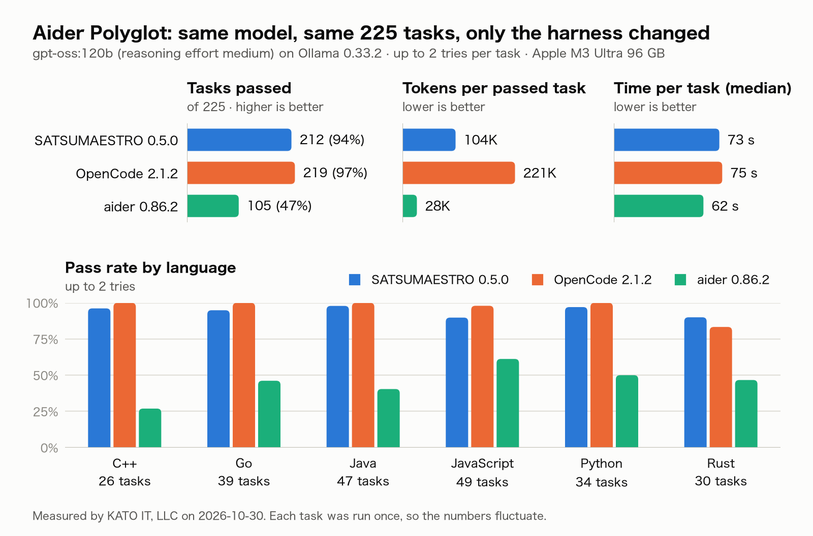

# SATSUMAESTRO

An agentic coding CLI for the terminal that also runs on local LLMs.

SATSUMAESTRO reads your code, plans, edits files and runs commands in a loop — it streams the
model's reply, calls tools, checks permissions, runs them and returns the results — until the task
is done. It is built to work well with models you run yourself on [Ollama](https://ollama.com), and
it can also use OpenAI-compatible servers and cloud APIs.

[日本語の README はこちら](https://github.com/KATOI-T/SATSUMAESTRO/blob/main/README.ja.md)

- **Local first**: use a model on your own machine or LAN. Requests go to the endpoint you set, and
  web search and web fetch are off by default.
- **Plan, then build**: plan mode writes a plan file and asks for your approval before changing
  anything. An approved plan runs step by step.
- **You decide what runs**: a permission policy in one Markdown file, confirmation cards, a
  workspace jail for file paths, and extra care for secret files.
- **English and Japanese**: replies follow the language you write in, and the screen can be English
  or Japanese.
- **Extras**: MCP servers, language servers (LSP), and a local search index (RAG) of your workspace.

## Contents

- [Requirements](#requirements)
- [Install](#install)
- [Quick start with Ollama](#quick-start-with-ollama)
- [Choosing a model](#choosing-a-model)
- [Context window](#context-window)
- [Comparison with other tools](#comparison-with-other-tools-aider-polyglot)
- [Using the REPL](#using-the-repl)
- [Providers](#providers)
- [Settings and trust](#settings-and-trust)
- [Permissions and safety](#permissions-and-safety)
- [Web search and web fetch](#web-search-and-web-fetch)
- [Optional features](#optional-features)
- [Using Ollama on another machine](#using-ollama-on-another-machine)
- [Contributing, security and license](#contributing-security-and-license)

## Requirements

- macOS, Linux, or Windows through WSL2 (see [Windows (WSL2)](#windows-wsl2)). Started natively on
  Windows, it stops at startup and points you to WSL2.
- Python 3.12 or later (`uv` installs it for you if needed).
- A model that supports **tool calling**, served by Ollama or another provider (see
  [Providers](#providers)). Some models only print tool calls as text and cannot run tools; with
  such a model SATSUMAESTRO stops with a clear error instead of showing raw JSON as the answer.

## Install

```bash
uv tool install satsumaestro      # or: pipx install satsumaestro
satsumaestro --version
```

`satsumaestro`, `satsuma` and `stro` are the same command. To install the latest source from
GitHub instead:

```bash
uv tool install git+https://github.com/KATOI-T/SATSUMAESTRO
```

Upgrade with `uv tool upgrade satsumaestro` and remove with `uv tool uninstall satsumaestro`.
If you do not have [uv](https://docs.astral.sh/uv/) yet: `curl -LsSf https://astral.sh/uv/install.sh | sh`.

With [Homebrew](https://brew.sh) on macOS or Linux:

```bash
brew install katoi-t/tap/satsumaestro
```

Upgrade with `brew upgrade satsumaestro` and remove with `brew uninstall satsumaestro`. The first
install builds a few dependencies from source and takes a few minutes.

### Windows (WSL2)

SATSUMAESTRO does not run natively on Windows. Use it inside WSL2 (Windows Subsystem for Linux):

1. Open PowerShell as administrator ("Run as administrator"), install WSL2 with Ubuntu, and restart
   Windows:
   ```powershell
   wsl --install
   ```
2. After the restart, Ubuntu opens and asks you to create a Linux user name and password. Later,
   start it from the Start menu or with `wsl` in PowerShell. `wsl -l -v` should show `VERSION 2`.
3. In the Ubuntu terminal, install uv and SATSUMAESTRO:
   ```bash
   curl -LsSf https://astral.sh/uv/install.sh | sh
   source $HOME/.local/bin/env        # or open a new terminal
   uv tool install satsumaestro
   ```
4. Set up Ollama in one of two ways, then continue with the [quick start](#quick-start-with-ollama):
   - **Inside Ubuntu** (simplest): `curl -fsSL https://ollama.com/install.sh | sh`. With an NVIDIA GPU,
     install the latest NVIDIA driver on Windows; WSL2 uses it, so do not install a GPU driver
     inside Ubuntu.
   - **Ollama for Windows**: to connect to it from WSL2, see Microsoft's
     [Accessing network applications with WSL](https://learn.microsoft.com/windows/wsl/networking).
5. Keep your projects in the Linux file system (for example `~/projects`), not under `/mnt/c/`.
   Reading and writing Windows files from WSL2 is much slower.

## Quick start with Ollama

1. Install [Ollama](https://ollama.com) and pull a model that fits your memory (see
   [Choosing a model](#choosing-a-model)):
   ```bash
   ollama pull qwen3:8b
   ```
2. Give the model a context window of 16K tokens or more (see [Context window](#context-window)).
3. Tell SATSUMAESTRO where Ollama is and which model to use, in `~/.satsuma/settings.json`:
   ```json
   {"provider": {"base_url": "http://localhost:11434/v1", "default_model": "qwen3:8b"}}
   ```
   Always set a model: without one, Ollama refuses the first request. The shell variables
   `OLLAMA_HOST` and `OLLAMA_MODEL` work too.
4. Check the setup, then start the REPL in your project:
   ```bash
   satsumaestro doctor --probe
   cd your-project
   satsumaestro repl
   ```
   The first time you open a directory, SATSUMAESTRO asks whether to trust it (see
   [Settings and trust](#settings-and-trust)). The first time you start the REPL, it asks which
   language to use on screen.

## Choosing a model

Up to two picks per memory size. The first is from the Qwen family, the second is gpt-oss (Qwen in
the 36–64 GB band).
All are official names you can `ollama pull`.

| Memory (Mac examples) | First pick | Second pick |
|---|---|---|
| 16 GB (16, 18 GB) | `qwen3:8b`, window 16K | — |
| 24–32 GB (24, 32 GB) | `qwen3:14b`, window 16K | `gpt-oss:20b`, window 32K |
| 36–64 GB (36, 48, 64 GB) | `qwen3-coder:30b`, window 32K | `qwen3.8:27b`, window 32K |
| 96 GB or more | `qwen3-coder-next:q4_K_M`, window 256K | `gpt-oss:120b`, window 128K |

- Each window is the largest at which the weights and the KV cache (at Ollama's default f16) fit in
  the memory the GPU may use. macOS lets the GPU use 2/3 to 3/4 of the memory: about 11 GB on
  16 GB, 21 GB on 32 GB, 27 GB on 36 GB and 36 GB on 48 GB.
- There is no second pick for 16 GB: `gpt-oss:20b` crashed on a 16 GB M2 Air, and `qwen3:14b`
  needs about 10.8 GB even with an 8K window, just over the limit.
- A 32K window in the 36–64 GB band is the same as Ollama's default on those GPUs, so you do not
  need to change the window. 48 GB or more also fits 64K, but we have not measured the difference
  in accuracy.
- The 16K for `qwen3:14b` and the 32K for `qwen3-coder:30b` and `qwen3.8:27b` are estimates
  calculated on the development machine, not checked on 24–64 GB machines.

## Context window

With a small context window (Ollama's `num_ctx`), the history is compacted at almost every write
and accuracy drops. Ollama decides the window in this order:

1. `PARAMETER num_ctx` in the model's Modelfile, if present
2. The server default `OLLAMA_CONTEXT_LENGTH` (Ollama's own default when unset, which is often small)

`satsumaestro doctor --probe` shows the breakdown on its `context window` line (the REPL shows it
again when you switch models with `/model`):

```
context window 16,384 tokens (num_ctx in the Modelfile): first request ~3,754 · room for the conversation ~9,353 (the history is compacted from 13,107)
```

- **First request**: the system prompt, instruction files and tool definitions, which are sent with
  every request. With a small window, instruction files are cut to 1/8 of the window.
- **Room for the conversation**: the compaction threshold (80% of the window) minus the first
  request. Your requests, the files read and the text written go here.
- If the room for the conversation is less than twice the first request (for example, an 8K
  model), the REPL suggests a larger window at startup.

To enlarge the window, use one of these (a larger window uses more memory; `ollama ps` shows the
size after loading):

- **Ollama app**: move the Context length slider in Settings
- **`ollama serve` (Homebrew and others)**: set the server default with `OLLAMA_CONTEXT_LENGTH`
- **Per model**: create a version with `PARAMETER num_ctx` in a Modelfile

```bash
OLLAMA_CONTEXT_LENGTH=16384 ollama serve            # when you start it yourself
launchctl setenv OLLAMA_CONTEXT_LENGTH 16384 && brew services restart ollama   # Homebrew service
```

```
# Modelfile (per model). Create it with: ollama create qwen3:8b-ctx16k -f Modelfile
FROM qwen3:8b
PARAMETER num_ctx 16384
```

See also [Context length](https://docs.ollama.com/context-length) in the Ollama documentation.

## Comparison with other tools (Aider Polyglot)

Same model, same tasks, same conditions, only the harness changed: all 225 tasks of Aider Polyglot
(C++, Go, Java, JavaScript, Python and Rust). Measured by us on 2026-10-30.



| | SATSUMAESTRO | OpenCode 2.1.2 | aider 0.86.2 |
|---|--:|--:|--:|
| Passed (up to 2 tries) | 212 (94.2%) | 219 (97.3%) | 105 (46.7%) |
| Passed on the first try | 183 (81.3%) | 186 (82.7%) | 36 (16.0%) |
| Failed | 13 | 6 | 120 |
| Time per task, median | 73 s | 75 s | 62 s |
| Tokens per passed task | 104K | 221K | 28K |
| Round trips per task, median | 8 | 13 | 2 |

Passed tasks by language (up to 2 tries):

| Language | Tasks | SATSUMAESTRO | OpenCode | aider |
|---|--:|--:|--:|--:|
| C++ | 26 | 25 | 26 | 7 |
| Go | 39 | 37 | 39 | 18 |
| Java | 47 | 46 | 47 | 19 |
| JavaScript | 49 | 44 | 48 | 30 |
| Python | 34 | 33 | 34 | 17 |
| Rust | 30 | 27 | 25 | 14 |
| **Total** | **225** | **212** | **219** | **105** |

- SATSUMAESTRO passed slightly fewer tasks than OpenCode (212 vs 219) in about the same time, and
  used less than half the tokens per passed task (it reads less per round trip and makes fewer
  round trips).
- aider was run the same way as aider's official benchmark. It does not run the tests itself, so its
  first-try pass rate is low. In this run it also checked C++ headers (`.h`) as C, which lowered C++
  in particular.
- Each task was run once, so the numbers fluctuate.

**Conditions**: gpt-oss:120b, reasoning effort medium (the same for all three), Ollama 0.33.2,
window 131072, Apple M3 Ultra 96 GB. Up to 2 tries per task (after a failed first try, the test
output is shown for one more try; 20 minutes per try, 3 minutes for tests). The three harnesses took
turns task by task. No web access. SATSUMAESTRO was the development version just before 0.5.0.
How to run it yourself is in [CONTRIBUTING.md](https://github.com/KATOI-T/SATSUMAESTRO/blob/main/CONTRIBUTING.md#evaluations).

## Using the REPL

```bash
satsumaestro repl                     # interactive REPL (recommended)
satsumaestro repl -m qwen3:14b        # with a different model
satsumaestro prompt "say hi"          # one-shot, non-interactive
satsumaestro prompt "plan a refactor of the auth code" --mode plan   # plan only; project files are not changed
satsumaestro prompt "say hi" --output-format json                    # JSON output
satsumaestro session list             # past sessions; resume with: satsumaestro session resume <id>
satsumaestro models                   # model shorthands
satsumaestro config show              # merged settings
satsumaestro doctor                   # health check of settings, provider, keys and policy
```

In the REPL, `/help` lists the commands, `/exit` or Ctrl-D quits, and Ctrl-C interrupts the
current turn. When the REPL closes, it unloads the model it used from Ollama (set
`provider.ollama.unload_on_exit: false` to keep it loaded).

**Modes**: the main mode is `plan` or `code` (default `code`). The prompt shows it as
`[plan] satsuma>` (green) or `[code] satsuma>` (blue).

- **Shift+Tab** switches between plan and code. `/mode` shows the current mode, and `/mode plan` or
  `/mode code read-only` sets it directly. `--mode plan|code|code:<sub>` sets it at startup. The
  mode is saved with the session.
- In **plan** mode, only read tools and writing the plan file `.satsuma/plans/<session_id>.md` are
  allowed. When the model calls `exit_plan_mode`, an **approval card** shows the plan: `y` approves
  and goes back to code mode to build it, `a` approves with a one-line note for the build (for
  example "add tests too"), and `n` asks the model to revise the plan with your one-line comment.
  Saying "go ahead" after a plan also counts as approval. `prompt` never approves a plan on its own.
- Under `code`, the permission sub-mode is one of `read-only`, `workspace-write` (default),
  `danger-full-access`, `prompt` and `allow`. The prompt shows it only when it is not the default,
  as in `[code:read-only]`. `/sub-mode` shows or changes it.

**Languages**: SATSUMAESTRO detects the language of each message and tells the model to reply in
it. If the reply comes back in another language, it asks once for a rewrite. Japanese and English
are supported.

- `/lang` shows the reply language, `/lang ja|en` fixes it and `/lang auto` goes back to detection.
  Settings: `language.mode` (`auto` / `fixed` / `off`), `language.fixed` and `language.repair`
  (`false` skips the rewrite round trip, which can take tens of seconds on local models).
- `/language ja|en|auto` sets the screen language (menus, cards, notices and help) and records it as
  `language.ui` in `~/.satsuma/settings.json`. It does not change the reply language.

**File changes**: while the model is generating the arguments of an edit, the content streams to the
screen, and a diff appears just before the edit runs (terminal only). `stream_tool_args: false`
turns off the streaming.

## Providers

SATSUMAESTRO picks the provider in this order:

1. `provider.base_url` or `OLLAMA_HOST` is set → that server (OpenAI-compatible). A model name alone
   never sends the request to a paid cloud API in this case.
2. The model ID names a vendor (for example `claude-…`, `gpt-…`, `grok-…`) → that vendor.
3. `OPENAI_BASE_URL` is set → that OpenAI-compatible server (mlx-lm, vLLM, OpenRouter and others).
4. The first API key found: `OPENAI_API_KEY`, `ANTHROPIC_API_KEY`, `XAI_API_KEY`.
5. Otherwise an OpenAI-compatible server, and SATSUMAESTRO tells you how to set the endpoint
   (`provider.base_url`, `OPENAI_BASE_URL` or `OLLAMA_HOST`).

If no endpoint is set, SATSUMAESTRO may choose a cloud provider from the API keys in your
environment. To keep requests on your own machine or LAN, set `provider.base_url` or `OLLAMA_HOST`.

The model comes from `--model` / `-m`, `OLLAMA_MODEL` or the setting `provider.default_model`.

## Settings and trust

Settings are layered in this order (later wins), and only the values not set there are filled from
`.env` and the environment:

1. `~/.satsuma/settings.json` (user settings; move it with `SATSUMA_CONFIG_HOME`)
2. `.satsuma.json`
3. `.satsuma/settings.json`
4. `.satsuma/settings.local.json`

Files 2–4, `.env`, `.satsuma/memory.md` and the skill folders are taken from the nearest directory
that has them, searching from the working directory up to the git root (only the working directory
outside git). `.satsuma/policy.md` files are stacked instead: the rules of every `policy.md` from the
git root down to the working directory apply, so a Deny at the root still holds in a subdirectory.
The base mode comes from the nearest file that sets `mode:`.

Session records, plans, the search index and other local state are written under `.satsuma/`. The
first time SATSUMAESTRO writes there, it adds `.satsuma/.gitignore` so that this state is not
committed; `settings.json`, `policy.md`, `memory.md` and `skills/` stay shareable.

Files 2–4, `.env`, `.satsuma/policy.md`, `.satsuma/memory.md` and `.satsuma/skills` can be committed
to a repository, and they can set hooks, MCP servers, LSP servers, the permission mode and the
endpoint. So SATSUMAESTRO reads them **only in directories you trust**.

- The first time you open a directory, `repl` asks: `y` trust and remember, `n` continue without
  them this time, `q` quit. Trust is recorded in `~/.satsuma/trusted.json` and covers everything
  under the root (the git root, or the directory itself).
- Non-interactive commands (`prompt`, `eval`, `config`, `mcp`, `rag`) never ask. In an untrusted
  directory they continue without those files and print one line on stderr.
- `satsumaestro trust` records, `trust list` lists and `trust remove` removes. `--trust` on `repl`,
  `prompt`, `session`, `eval`, `config`, `mcp`, `rag` or `doctor` trusts the directory for that run
  only. `doctor` shows the state on its `trust` line.
- In an untrusted directory, `a` (allow from now on) on a confirmation card lasts only for the
  session.
- Put settings you use everywhere, such as the provider endpoint, in the user settings (1).

### Instruction files

SATSUMAESTRO reads one instruction file at the workspace root (the git root; outside git, the nearest
ancestor with `.satsuma/` or `.satsuma.json`, or the working directory) and one in the working
directory, and adds them to the system prompt (one file if both are the same place). It does not
look at directories in between or above the root.

In each place it reads the first one found in this order. A `SATSUMA.md` means the `CLAUDE.md` and
`AGENTS.md` next to it are not read (empty files are skipped).

1. `.satsuma/SATSUMA.md` → `SATSUMA.md`
2. `.satsuma/CLAUDE.md` → `CLAUDE.md`
3. `.satsuma/AGENTS.md` → `AGENTS.md`

- The root comes first and the working directory second, so the working directory wins on conflicts.
- Up to 16,000 characters in total. Beyond that the text is cut, and the model is told which files
  were cut or left out (it can read them with `read_file` if needed).
- Instruction files are plain text that is never run, so they are read even in untrusted
  directories.

## Permissions and safety

The default permission mode is `workspace-write`: read tools and file writes inside the workspace
run without asking, while bash commands and deleting files ask first. `repl` shows a confirmation
card (`Allow this? [y=allow / n=deny / a=always allow / d=details]:`); `prompt` (non-interactive)
refuses tools that need confirmation, so it never hangs waiting for input.

You can design the permissions in one file, `.satsuma/policy.md` (Deny, Ask and Allow rules plus a
base mode). Start from
[`.satsuma/policy.md.example`](https://github.com/KATOI-T/SATSUMAESTRO/blob/main/.satsuma/policy.md.example);
without the file, the default mode applies.

**What runs without asking by default**

- Read tools: `read_file`, `glob_search`, `list_directory`, `grep_search` and `rag_search`.
- File writes inside the workspace: `write_file`, `edit_file`, `append_file` and `notebook_edit`
  (secret files and SATSUMAESTRO's own settings files still ask, see below).
- Bash commands that are provably read-only, such as `ls`, `cat`, `head`, `grep <file>`, `find`,
  `git status`, `git log` and `git diff`. These still ask (and are refused in `prompt`): writes and
  redirections (`>`), variable expansion with `$`, environment prefixes (`FOO=1 cmd`), paths outside
  the workspace (`/etc/hosts`, `~/`), secret files and recursive searches (`grep -r`, `rg`). Deny and
  Ask rules in `.satsuma/policy.md` always come first. Turn this off with
  `"permission": {"bash_auto_allow": "off"}`.
- git commands run this way get `safe.bareRepository=explicit` and `core.fsmonitor=false`, so a bare
  repository planted in the working directory is not opened implicitly.

**Secret files** (`.env`, `.env.*`, `*.pem`, `*.key`, `.ssh/` and so on): the file tools (`read_file`,
`edit_file`, `write_file`, `append_file` and `notebook_edit`) always ask before touching them, even
where reading or writing is otherwise allowed (refused in `prompt`).
`grep_search` skips them and lists the skipped files in one line, and `rag ingest` leaves them out of
the index. To allow a specific file, name its path in `## Allow` of `.satsuma/policy.md` (for
example `- read_file when path glob: .env`) or choose `a` on the card.
`"permission": {"secret_access": "deny"}` refuses instead of asking.

**SATSUMAESTRO's own settings**: writes to `.satsuma.json` and `.env` always ask, in every permission
mode and even when `## Allow` names the path, and `a` cannot remember them (refused in `prompt`).
The same holds for bash commands that write these files.

**Limits of the sandbox**: bash runs with the workspace as its working directory, and redirections
are confined to the workspace. There is no OS-level isolation (namespaces, seccomp). The bash checks
are an extra layer of warnings; the real guards are the workspace jail and the permission policy.

**Keys and records**: API keys that SATSUMAESTRO reads (`ANTHROPIC_API_KEY`, `OPENAI_API_KEY`,
`XAI_API_KEY`, `SATSUMA_EMBED_API_KEY`) and names matching `*_API_KEY` are removed from the
environment of child processes (bash, hooks, LSP servers); adjust with `sandbox.env_strip` and
`sandbox.env_keep`. `config show` masks `mcp_servers.*.env`. Session records (`.satsuma/sessions/`)
are saved with these replaced by `[redacted]`: the values of the keys above, values given to
secret-like names (such as `API_KEY=…` or `password: …`), `Authorization:` headers, keys in URL
queries and key-shaped tokens (such as `sk-…` and `ghp_…`). Other secrets in tool output are saved as
they are.

**Telemetry**: SATSUMAESTRO sends no usage data anywhere. `telemetry.enabled` (off by default) only
counts turns and tool runs in memory for `/insights`, or in a local file set with
`telemetry.jsonl_file`.

Found a vulnerability? Please report it privately, as described in [SECURITY.md](https://github.com/KATOI-T/SATSUMAESTRO/blob/main/SECURITY.md).

## Web search and web fetch

Both are **off by default** and are not shown to the model as tools.

**Web search** (`web_search`) sends search terms written by the model to a third-party service, so
you choose the backend. A self-hosted [SearXNG](https://github.com/searxng/searxng) is recommended:

```json
{"web_search": {"provider": "searxng", "base_url": "http://localhost:8080"}}
```

The repository has a ready-made Docker setup for SearXNG in
[`docker/`](https://github.com/KATOI-T/SATSUMAESTRO/tree/main/docker) (`make searxng-up` in a
clone). `"provider": "duckduckgo"` also works, but it uses DuckDuckGo's unofficial HTML page, falls
under its terms of use and bot detection, and may go silent after many requests. The environment
variables `SATSUMA_WEB_SEARCH_PROVIDER` and `SATSUMA_WEB_SEARCH_BASE_URL` work too.

**Web fetch** (`web_fetch`) reads a page at a URL. Turn it on with
`{"web_fetch": {"enabled": true}}` (or `SATSUMA_WEB_FETCH_ENABLED=true`). When on:

- It asks before the first fetch in a session, showing the host (refused in `prompt`).
- It never fetches non-public addresses (`localhost`, private ranges such as `10.x` and
  `192.168.x`, the cloud metadata address `169.254.169.254`), and checks every redirect the same way.
- It reads at most 2 MB of the body.

```json
{"web_fetch": {"enabled": true, "confirm": "first-use", "allow_private_hosts": false, "max_bytes": 2000000}}
```

`confirm` is `first-use` (default), `always` or `never`. Set `allow_private_hosts: true` only to read
a server on your own network. A rule naming the URL in `## Allow` of `.satsuma/policy.md` (for
example `- web_fetch when url glob: https://docs.python.org/*`) passes without asking.

## Optional features

**Workspace search index (RAG)**: SATSUMAESTRO splits your code into chunks, embeds them and stores
them in a SQLite vector index (`.satsuma/rag.db`), so the model can search it by meaning with the
`rag_search` tool (available only when an index exists).

```bash
satsumaestro rag ingest                          # index the working directory (re-runs are incremental)
satsumaestro rag search "where is authentication done?"
satsumaestro rag stats
```

Embeddings run on local Ollama (default `bge-m3`; `ollama pull bge-m3`). Change them with
`SATSUMA_EMBED_BASE_URL` and `SATSUMA_EMBED_MODEL`. If the embedding server is unreachable, the
conversation goes on and only `rag_search` returns an error.

**Code intelligence (LSP)**: with a language server on your PATH, the `lsp` tool offers diagnostics,
go to definition, references, hover and more (Python: `pyright-langserver` or `pylsp`;
TypeScript/JavaScript: `typescript-language-server`; Go: `gopls`). Check what was found on the `lsp`
line of `satsumaestro doctor`. Any server can be set with `lsp.servers`, for example
`{"lsp": {"servers": {"python": ["uvx", "--from", "python-lsp-server[pyflakes]", "pylsp"]}}}`.
A language server is a separate program that reads your files, so SATSUMAESTRO asks before
starting one for each language (once per session; refused in `prompt`). Skip the question with
`{"lsp": {"confirm_start": false}}`.

**MCP servers**: add servers under `mcp_servers` in the settings, then check them with
`satsumaestro mcp list`:

```json
{"mcp_servers": {"files": {"transport": "stdio", "command": "npx", "args": ["-y", "@modelcontextprotocol/server-filesystem", "."]}}}
```

`transport` is `stdio` (with `command`, `args` and `env`) or `streamable-http` (with `url`). Tools
from MCP servers go through the same permission checks as built-in tools, and each call asks first
unless a rule in `## Allow` of `.satsuma/policy.md` names the tool.

**Skills**: put instructions for a recurring task in `<name>/SKILL.md` under `.satsuma/skills/`,
`.claude/skills/` (the same place as Claude Code) or `~/.satsuma/skills/`. The model sees the list
of skills and loads one with the `skill` tool when it fits the task.

## Using Ollama on another machine

Every endpoint comes from settings or environment variables, so SATSUMAESTRO and Ollama can run on
different machines.

**Client (SATSUMAESTRO)**: point the URLs at the other machine, for example in `.env` or the shell:

```bash
OLLAMA_HOST=http://192.168.x.x:11434                 # main model (/v1 is added for you)
SATSUMA_EMBED_BASE_URL=http://192.168.x.x:11434/v1   # RAG embeddings (only if used)
SATSUMA_WEB_SEARCH_BASE_URL=http://192.168.x.x:8080  # SearXNG (only if used)
```

- For the main model, `provider.base_url` (settings) wins over `OLLAMA_HOST`, which wins over
  `OPENAI_BASE_URL`.
- Non-empty `OLLAMA_*` values in `.env` take precedence over the shell. At startup SATSUMAESTRO checks
  that `/api/tags` is reachable and stops right away with the endpoint if it is not.
- Ollama-specific features (keep_alive, matching the context length) are enabled when the port is
  11434 or the URL matches `OLLAMA_HOST`. Behind a reverse proxy without `OLLAMA_HOST`, set
  `provider.ollama.detect: "on"`.

**Server (Ollama)**: Ollama listens only on `127.0.0.1:11434` by default. To accept other machines,
restart it with `OLLAMA_HOST=0.0.0.0:11434` set on the server side.

> **Security**: neither Ollama nor SearXNG has authentication. Exposed on `0.0.0.0`, anyone on the
> same network can use them. Keep them inside a trusted LAN or use an SSH tunnel or VPN, and never
> expose them directly to the internet.

## Contributing, security and license

- **Contributing**: see [CONTRIBUTING.md](https://github.com/KATOI-T/SATSUMAESTRO/blob/main/CONTRIBUTING.md) (development setup, tests and the DCO
  sign-off) and our [Code of Conduct](https://github.com/KATOI-T/SATSUMAESTRO/blob/main/CODE_OF_CONDUCT.md).
- **Security**: report vulnerabilities privately, as described in [SECURITY.md](https://github.com/KATOI-T/SATSUMAESTRO/blob/main/SECURITY.md).
- **Changes**: see [CHANGELOG.md](https://github.com/KATOI-T/SATSUMAESTRO/blob/main/CHANGELOG.md).
- **License**: SATSUMAESTRO is licensed under the [Apache License 2.0](https://github.com/KATOI-T/SATSUMAESTRO/blob/main/LICENSE). Notices for
  third-party material in the tests and evaluation suites are in [NOTICE](https://github.com/KATOI-T/SATSUMAESTRO/blob/main/NOTICE).
- **Trademark**: SATSUMAESTRO is a trademark of KATO IT, LLC (application pending). See
  [TRADEMARK.md](https://github.com/KATOI-T/SATSUMAESTRO/blob/main/TRADEMARK.md) for how the name may be used.
- **Official sources**: the only official repository and distribution channels are
  <https://github.com/KATOI-T/SATSUMAESTRO>, the `satsumaestro` package on PyPI
  (<https://pypi.org/project/satsumaestro/>) and the Homebrew tap `katoi-t/tap`
  (<https://github.com/KATOI-T/homebrew-tap>). Copies elsewhere are not maintained by us.

SATSUMAESTRO is not affiliated with Anthropic or OpenAI. It reads instruction files written for
other tools as they are, such as `CLAUDE.md` (Claude Code) and `AGENTS.md` (OpenAI Codex and
others), and follows some Claude Code conventions such as `<system-reminder>` tags. Other product
names are trademarks of their respective owners.
